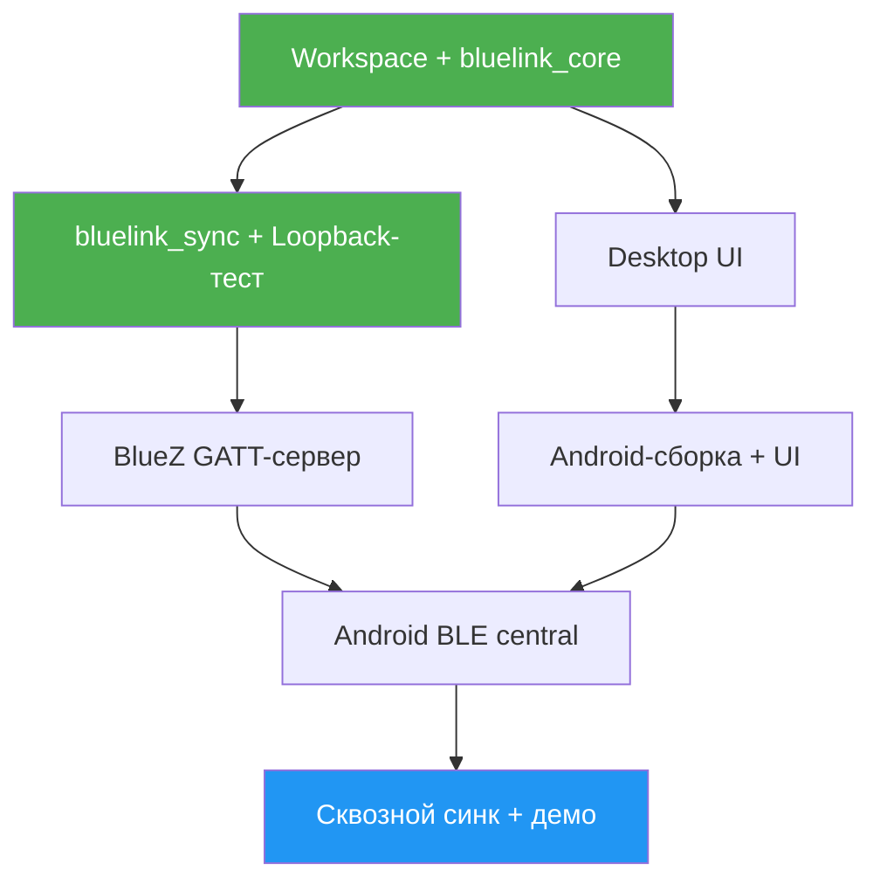

# ТЗ: BlueLink
> Формат: личный однодневный спринт (не хакатон)
> Длительность: 1 день (~12 часов фокуса)
> Дата генерации: 2026-10-24
> Версия: 2.0

---

## Описание проекта

### Проблема
Нужен локальный аналог Obsidian: заметки в Markdown, `[[wikilinks]]`, работа на ПК и телефоне. Облако не используется — устройства синхронизируются напрямую по Bluetooth, только после явного паринга.

### Решение
**BlueLink** — нативное приложение на Rust:
- один UI-код (`egui`) для Linux desktop и Android — без WebView и Electron;
- общий core: vault на файловой системе, индекс ссылок, протокол синхронизации;
- паринг по 6-значному коду через PAKE (SPAKE2), дальше устройства узнают друг друга по криптографическому ключу, а не по BLE-адресу;
- синхронизация по BLE GATT с зашифрованным каналом (Noise) и трёхсторонним сравнением изменений.

### Целевая аудитория
Личное использование: один пользователь, ПК + телефон, офлайн.

### Ключевая ценность
- Данные — обычная папка `.md`, открывается любым редактором (и Obsidian тоже).
- Нет облака: заметки передаются только между доверенными устройствами рядом.
- Один Rust-код на обеих платформах: UI, логика и протокол не дублируются.

---

## Команда

| Имя | Роль | Зона ответственности |
|-----|------|----------------------|
| Я | full-stack (Rust) | core, sync, BLE, UI, Android-сборка, демо |

---

## Стек технологий

| Слой | Технология | Назначение |
|------|-----------|-----------|
| Язык / runtime | Rust stable, `tokio` | общий async-runtime для BLE и sync |
| UI (desktop + Android) | `eframe` + `egui`, иконки `egui-phosphor` | один UI-crate на обе платформы, нативный рендер (wgpu/glow) |
| Markdown | `pulldown-cmark` | парсинг для preview и извлечения ссылок |
| BLE на ПК (peripheral) | `bluer` (BlueZ) | GATT-сервер + advertising на Linux |
| BLE на Android (central) | `btleplug` (Android backend через JNI) | scan + connect + GATT-клиент |
| Паринг | `spake2` | обмен ключами по 6-значному коду без утечки кода при перехвате |
| Защищённый канал | `snow` (`Noise_XX_25519_ChaChaPoly_SHA256`) | шифрование и взаимная аутентификация по статическим ключам |
| Сериализация | `serde` + `postcard` | компактные бинарные фреймы (BLE медленный) |
| Хэши | `sha2` | SHA-256 содержимого заметок |
| Слежение за файлами | `notify` (desktop) | заметить правки, сделанные внешним редактором |
| Логи | `tracing` + `tracing-appender` | файл логов с ротацией |
| Android-сборка | `cargo-ndk` + минимальный Gradle-проект | нужен для `NativeActivity`, манифеста, разрешений и Java-классов `btleplug` |

### Почему роли BLE распределены так
- `btleplug` умеет быть только **central** (клиентом). Поэтому GATT-сервером (peripheral) выступает ПК через `bluer`/BlueZ.
- Телефон — central: сканирует, подключается к ПК и запускает синхронизацию.
- Синк ПК ↔ ПК и телефон ↔ телефон в MVP не поддерживается.

### Структура репозитория

```
bluelink/
├── crates/
│   ├── bluelink_core/     # vault: CRUD, атомарная запись, валидация путей, wiki-индекс, markdown
│   ├── bluelink_sync/     # протокол, pairing (SPAKE2), Noise-сессия, план синка, trust store, Transport trait + loopback
│   ├── bluelink_ble/      # Transport поверх BLE: feature "bluez" (ПК), feature "android" (btleplug)
│   └── bluelink_ui/       # egui-экраны: дерево, редактор, preview, устройства, статус синка
├── apps/
│   ├── desktop/           # main.rs: eframe + bluez transport
│   └── android/           # cdylib + gradle-проект (AndroidManifest, разрешения)
├── Cargo.toml             # workspace
└── README.md              # сборка, запуск, демо-сценарий, известные ограничения
```

### Данные на диске

```
<vault>/
├── *.md                         # заметки (source of truth)
└── .bluelink/                   # служебное, в синк не попадает
    ├── device.json              # device_id, имя устройства, статический X25519-ключ (приватный)
    ├── trusted.json             # доверенные устройства: device_id, имя, public key, дата паринга
    ├── sync_state/<peer_id>.json# база для 3-way: rel_path -> sha256 на момент последнего синка
    └── logs/                    # логи, ротация, максимум 5 файлов по 2 MiB
```

На Android vault лежит во внутреннем хранилище приложения (`filesDir/vault`). Доступ к общим папкам (SAF) в MVP не делается.

---

## Функциональные требования

### Must Have (MVP — без этого не готово)
- [ ] **Vault** — открыть/создать папку (desktop: диалог или `--vault <path>`; Android: внутреннее хранилище)
- [ ] **Дерево заметок** — список `.md` с вложенными папками; создать, переименовать, удалить
- [ ] **Редактор** — plaintext-редактирование, автосохранение через 1 с после последней правки + `Ctrl+S`
- [ ] **Preview** — заголовки, списки, жирный/курсив, код, цитаты, ссылки; переключение «Редактор / Preview» (на телефоне — вкладки)
- [ ] **`[[wikilinks]]`** — `[[Note]]`, `[[Note|алиас]]`, `[[folder/Note]]`; клик открывает заметку, отсутствующую — предлагает создать
- [ ] **Паринг по коду** — ПК показывает 6-значный код (TTL 120 с, максимум 3 попытки), телефон вводит; при успехе обе стороны сохраняют ключ друг друга
- [ ] **Запоминание устройств** — повторное подключение без кода; работает после перезапуска и смены BLE-адреса
- [ ] **Отзыв доверия** — удалить устройство из списка; дальше нужен новый код
- [ ] **Синхронизация** — кнопка «Синхронизировать» на телефоне; двусторонняя, только `.md`, включая удаления
- [ ] **Конфликты** — если файл изменён на обеих сторонах, локальная версия остаётся, удалённая сохраняется рядом как `Name.conflict-<устройство>-<YYYY-MM-DD HH-MM>.md`
- [ ] **Статус синка** — состояние (ожидание / паринг / подключение / передача N из M / ошибка) и журнал последних 50 событий с временем в 24-часовом формате

### Should Have (если останется время)
- [ ] Поиск по содержимому vault
- [ ] Панель обратных ссылок (backlinks)
- [ ] Автосинк, когда доверенный ПК рядом (раз в 5 минут, пока приложение открыто)
- [ ] Переименование заметки с обновлением ссылок `[[...]]`

### Won't Have (явно вне скопа)
- iOS, Windows, macOS
- Плагины, темы, graph view, Canvas, Bases
- Облачный синк, Publish, мультипользовательский режим
- Синк вложений (картинки, PDF) — только `.md`
- Classic Bluetooth / L2CAP CoC — только GATT
- Автоматический merge текста при конфликте
- Фоновый синк на Android при закрытом приложении

---

## Контракты (вместо HTTP API)

> HTTP-сервера нет. Контракты — это публичный API крейтов и бинарный протокол поверх BLE.
> UI вызывает только `bluelink_core` и `bluelink_sync`; к файлам и BLE напрямую не обращается.
> Ошибки — Rust enum, ниже указаны их варианты.

### Core — `bluelink_core`

#### `Vault::open(root: &Path) -> Result<Vault, VaultError>`
**Описание:** открыть папку, создать `.bluelink/` при первом запуске, построить индекс ссылок.

**Errors:**
| Вариант | Причина |
|-----|---------|
| `NotADirectory` | путь не папка |
| `PermissionDenied` | нет прав на чтение/запись |
| `CorruptMeta` | `.bluelink/device.json` не читается — показать ошибку, не перезаписывать молча |

---

#### `Vault::list() -> Vec<NoteMeta>`
**Response:**
```json
{
  "notes": [
    {
      "rel_path": "string // 'inbox/todo.md', всегда '/' как разделитель",
      "sha256": "string // hex содержимого",
      "size": "u64 // байты",
      "modified": "u64 // unix ms, только для UI, в логике синка не используется"
    }
  ]
}
```

---

#### `Vault::read(rel_path) -> Result<String, VaultError>` / `Vault::write(rel_path, content) -> Result<NoteMeta, VaultError>`
**Описание:** запись атомарная — временный файл в той же папке, `fsync`, `rename`. После записи обновляется индекс ссылок.

**Errors:**
| Вариант | Причина |
|-----|---------|
| `NotFound` | файла нет |
| `InvalidPath` | путь не прошёл валидацию (см. ниже) |
| `TooLarge` | больше 1 MiB |
| `NotUtf8` | файл не UTF-8 — показать как «только чтение», не синкать |

**Валидация путей (граница доверия — пути приходят и от другого устройства):**
- только относительные пути, без `..`, без начального `/`, без `\`;
- расширение `.md`, длина пути до 255 байт;
- служебная папка `.bluelink/` и скрытые файлы запрещены;
- итоговый путь после `canonicalize` обязан лежать внутри корня vault.

---

#### `Vault::delete(rel_path)` / `Vault::rename(from, to)`
**Описание:** удаление и переименование. Переименование для синка выглядит как удаление + создание.

---

#### `WikiIndex::resolve(link: &str) -> Option<RelPath>` / `WikiIndex::backlinks(rel_path) -> Vec<RelPath>`
**Правила резолва:**
1. Точное совпадение пути без `.md` (`folder/Note` → `folder/Note.md`).
2. Иначе — совпадение имени файла без учёта регистра; если таких несколько, берётся самый короткий путь.
3. Часть после `|` — алиас (только отображение), после `#` — заголовок (в MVP игнорируется).

---

### Pairing и доверие — `bluelink_sync::pairing`

#### `Pairing::host() -> HostSession` (ПК)
**Описание:** генерирует код, начинает advertising с флагом «паринг открыт».

**Response:**
```json
{
  "code": "string // 6 цифр, криптостойкий RNG",
  "expires_at": "u64 // unix ms, TTL 120 с",
  "attempts_left": "u8 // 3"
}
```

#### `Pairing::join(peer, code) -> Result<TrustedDevice, PairingError>` (телефон)
**Поток:**
1. Телефон подключается к ПК, обе стороны выполняют SPAKE2, используя код как пароль, и получают общий ключ `K`. Перехват трафика не позволяет подобрать код офлайн.
2. Обмен подтверждениями `HMAC(K, transcript)`: неверный код обнаруживается здесь.
3. Под ключом `K` стороны обмениваются `device_id`, именем устройства и статическим X25519 public key.
4. Обе стороны записывают друг друга в `trusted.json`.

**Response:**
```json
{
  "device_id": "string // uuid v4, создаётся при первом запуске",
  "name": "string // 'Pixel 8', 'cachyos-desktop'",
  "public_key": "string // base64 X25519 static key",
  "paired_at": "u64 // unix ms"
}
```

**Errors:**
| Вариант | Причина |
|-----|---------|
| `WrongCode` | подтверждение не совпало; `attempts_left -= 1` |
| `Expired` | TTL вышел или попытки кончились — нужен новый код |
| `NotInPairingMode` | на ПК не открыт паринг |
| `Transport(..)` | обрыв BLE |

#### `TrustStore::list() / revoke(device_id)`
**Описание:** список доверенных устройств и отзыв. Отозванное устройство получает `Untrusted` при следующем подключении.

---

### BLE-транспорт — `bluelink_ble`

**GATT-сервис BlueLink** (UUID зафиксировать в коде и README):

| Характеристика | Свойства | Направление |
|----------------|----------|-------------|
| `rx` | Write Without Response | телефон → ПК |
| `tx` | Notify | ПК → телефон |
| `info` | Read | `protocol_version`, `pairing_open` (bool) |

**Фрагментация:** ATT MTU согласуется до 247 (на Android — `requestMtu`). Каждый BLE-пакет: `[u8 flags: first/last][u16 seq][payload]`. Сообщение протокола собирается из фрагментов; максимальный размер одного сообщения — 64 KiB.

**Trait для тестов и подмены транспорта:**
```rust
#[async_trait]
pub trait Transport: Send {
    async fn send(&mut self, frame: &[u8]) -> Result<(), TransportError>;
    async fn recv(&mut self) -> Result<Vec<u8>, TransportError>;
}
```
Реализации: `BluezPeripheral` (ПК), `BtleplugCentral` (Android), `Loopback` (тесты — весь протокол проверяется без Bluetooth).

---

### Протокол синхронизации — `bluelink_sync::proto`

Все сообщения после handshake шифрует Noise (`snow`); сериализация — `postcard`.

#### 1. Handshake `Noise_XX`
Стороны обмениваются статическими ключами. Если ключ собеседника не найден в `trusted.json`, соединение закрывается с `Untrusted`. Устройство опознаётся по ключу, а не по MAC-адресу — Android меняет BLE-адрес, и привязка к нему ломала бы «запоминание».

#### 2. `Hello`
```json
{
  "type": "Hello",
  "protocol": "u16 // 1",
  "device_id": "string",
  "app_version": "string"
}
```
Ответ — `HelloAck` с теми же полями. Разные `protocol` → `ProtocolMismatch`, соединение закрывается.

#### 3. `Manifest` (обе стороны)
```json
{
  "type": "Manifest",
  "notes": [
    { "rel_path": "string", "sha256": "string", "size": "u64" }
  ]
}
```
Если заметок больше 500, манифест разбивается на части (`part`, `total`).

#### 4. План (считает телефон — инициатор)
Для каждого пути из объединения манифестов: `L` — локальный hash, `R` — удалённый, `B` — база из `sync_state/<peer>.json` (отсутствие файла = `None`).

| Условие | Действие |
|---------|----------|
| `L == R` | ничего, `B := L` |
| `L == B`, `R != B` | взять с удалённой стороны (если `R = None` — удалить локально) |
| `R == B`, `L != B` | отправить на удалённую сторону (если `L = None` — удалить там) |
| `L != B`, `R != B`, `L != R` | конфликт |
| `B` нет, есть только одна сторона | скопировать недостающее |
| `B` нет, обе стороны есть и различаются | конфликт |

**Конфликт:** локальный файл не трогается; удалённая версия пишется как `Name.conflict-<имя устройства>-<YYYY-MM-DD HH-MM>.md` (24-часовой формат). Если с одной стороны файл удалён, а с другой изменён, удаление проигрывает и файл восстанавливается.

Если файл открыт в редакторе с несохранёнными правками, он считается изменённым локально — синк не перезапишет текст, который пользователь сейчас набирает.

#### 5. Передача
```json
{ "type": "Get", "rel_path": "string", "sha256": "string" }
```
```json
{ "type": "Put", "rel_path": "string", "sha256": "string", "offset": "u64", "last": "bool", "data": "bytes // до 16 KiB" }
```
```json
{ "type": "Delete", "rel_path": "string", "expected_sha256": "string // удалить только если hash совпадает" }
```
Принимающая сторона проверяет путь, размер и SHA-256 собранного файла **до** записи; несовпадение → `IntegrityError`, файл не пишется.

#### 6. `Commit`
После всех операций обе стороны записывают новую базу `B` для этого собеседника. Если синк оборвался до `Commit`, база не меняется, и следующий синк просто повторит недоделанное (операции идемпотентны по hash).

**Ошибки протокола:**
| Вариант | Причина |
|-----|---------|
| `Untrusted` | ключ не в trust store |
| `ProtocolMismatch` | разные версии протокола |
| `InvalidPath` / `TooLarge` | нарушение валидации |
| `IntegrityError` | hash не совпал |
| `Timeout` | нет сообщений 30 с |

---

## Ограничения и надёжность

| Что ограничено | Значение | Поведение при превышении |
|----------------|----------|--------------------------|
| Размер заметки | 1 MiB | пропустить файл, записать в журнал |
| Количество заметок | 5 000 | синк отказывает с понятной ошибкой |
| Сообщение протокола | 64 KiB | разрыв соединения |
| Тишина в канале | 30 с | `Timeout`, разрыв |
| Весь синк | 10 минут | отмена, база не меняется |
| Повторы подключения | 3 попытки, пауза 1 / 2 / 4 с ± 20% | после — ошибка в статусе |
| Попытки ввода кода | 3 | сессия паринга закрывается |
| Логи | 5 файлов × 2 MiB | ротация |

- Повторы делаются только при ошибках транспорта; `Untrusted`, `ProtocolMismatch` и `IntegrityError` не повторяются.
- Кнопка «Отмена» в любой момент синка; отмена не портит vault (атомарная запись + база меняется только на `Commit`).
- UI не блокируется: BLE и синк работают в `tokio`, UI получает события по каналу.

---

## Разрешения и окружение

### Linux (ПК)
- Запущен `bluetoothd` (BlueZ ≥ 5.60), адаптер включён (`bluetoothctl power on`).
- Пользователь имеет доступ к BlueZ через D-Bus (обычно достаточно стандартной policy; иначе — группа `bluetooth`).

### Android
- `minSdk 29`, `targetSdk 34`.
- Android 12+: `BLUETOOTH_SCAN` (`neverForLocation`), `BLUETOOTH_CONNECT`.
- Android 10–11: `ACCESS_FINE_LOCATION` для сканирования.
- Запрос разрешений при первом нажатии «Подключить», понятный отказ в UI, если пользователь не дал доступ.

---

## UI

| Экран | Desktop | Android |
|-------|---------|---------|
| Заметки | дерево слева, редактор/preview справа | список → экран заметки, вкладки «Текст / Просмотр» |
| Устройства | список доверенных, кнопки «Показать код», «Отозвать» | список доверенных, «Добавить устройство» (поиск + ввод кода), «Отозвать» |
| Синк | статус + журнал | статус + журнал + кнопки «Синхронизировать» / «Отмена» |

- Иконки — `egui-phosphor`, без эмодзи.
- Все времена в 24-часовом формате (`HH:MM`).
- Текст и кнопки минимум 48 dp на телефоне, контраст тёмной темы проверить вручную.

---

## Задачи

> Порядок важен: всё, что можно проверить без Bluetooth, делается и проверяется до Bluetooth.

### Я — full-stack (Rust)
- [ ] **Workspace** — 4 крейта + `apps/desktop`, CI-команда `cargo test --workspace`
- [ ] **bluelink_core** — vault, валидация путей, атомарная запись, wiki-индекс, markdown → preview-модель
- [ ] **bluelink_ui + desktop** — дерево, редактор, preview, wikilinks, автосохранение
- [ ] **bluelink_sync** — pairing (SPAKE2), Noise-сессия, trust store, план синка, протокол, `Loopback`
- [ ] **Тест синка** — `crates/bluelink_sync/tests/sync.rs` на `Loopback`: паринг, неверный код, обычный синк, конфликт, удаление, обрыв до `Commit`, `Untrusted`
- [ ] **bluelink_ble: bluez** — GATT-сервер на ПК, advertising, фрагментация
- [ ] **Android-сборка** — gradle-проект, `cargo-ndk`, eframe на `NativeActivity`, тот же `bluelink_ui`
- [ ] **bluelink_ble: android** — `btleplug` central, MTU, разрешения
- [ ] **README** — сборка, запуск, демо, известные ограничения

---

## Roadmap

| Этап | Задача | Дедлайн (ч. от старта) |
|------|--------|------------------------|
| 1 | Workspace + `bluelink_core` + тесты путей | +1.5ч |
| 2 | Desktop UI: дерево, редактор, preview, wikilinks | +4ч |
| 3 | `bluelink_sync`: протокол, план, pairing, Noise + тест на `Loopback` | +6.5ч |
| 4 | BlueZ GATT-сервер на ПК (spike — проверить, что BLE-сканер с телефона видит сервис) | +8ч |
| 5 | Android: сборка + UI на телефоне | +10ч |
| 6 | Android BLE central + сквозной синк ПК ↔ телефон | +11.5ч |
| 7 | README + прогон демо | +12ч |

### Граф зависимостей задач



> Зелёный — стартует первым и проверяется без Bluetooth
> Синий — финальная точка
> Стрелка A → B: B не начинается без A

---

## Этапы и проверка

### Блок 1: Vault core
**Готово когда:** заметки создаются, читаются, удаляются; ссылки резолвятся; опасные пути отклоняются.

#### Чеклист проверки
- [ ] **Атомарность** — убить процесс во время записи: файл либо старый, либо новый, не обрезанный
- [ ] **Пути** — `../x.md`, `/etc/x.md`, `.bluelink/trusted.json` → `InvalidPath`
- [ ] **Ссылки** — `[[note]]`, `[[Folder/Note|алиас]]` резолвятся по правилам
- [ ] **Не-UTF-8 файл** — открывается только для чтения, не падает

#### Fallback
- **Если индекс ссылок тормозит** — линейный поиск по списку файлов при каждом клике
- **Минимально рабочая версия:** read/write/list без индекса

---

### Блок 2: Desktop UI
**Готово когда:** обычная работа с заметками без синка удобна и не теряет текст.

#### Чеклист проверки
- [ ] **Автосохранение** — правка → через 1 с файл на диске обновлён
- [ ] **Внешняя правка** — изменить файл другим редактором → BlueLink показывает новую версию (если нет несохранённых правок)
- [ ] **Wikilink** — клик открывает заметку; клик по несуществующей предлагает создать
- [ ] **Preview** — заголовки, списки, код отображаются корректно

#### Fallback
- **Если preview не успевает** — только редактор, preview — Should Have
- **Если диалог выбора папки не работает** — только `--vault <path>`
- **Минимально рабочая версия:** дерево + редактор + сохранение

---

### Блок 3: Sync-протокол без Bluetooth
**Готово когда:** `cargo test -p bluelink_sync` зелёный на `Loopback`.

#### Чеклист проверки
- [ ] **Паринг** — правильный код → оба trust store содержат друг друга
- [ ] **Неверный код ×3** — сессия закрыта, trust store пуст
- [ ] **Синк** — новый файл, изменённый файл, удалённый файл доходят до другой стороны
- [ ] **Конфликт** — правка с обеих сторон → `*.conflict-*.md`, локальный текст цел
- [ ] **Обрыв до `Commit`** — повторный синк доводит дело до конца, без дублей
- [ ] **Чужой ключ** — `Untrusted`, ни одного файла не передано

#### Fallback
- **Если Noise не заводится** — шифровать фреймы `ChaCha20-Poly1305` ключом из SPAKE2 + сохранённым общим секретом; в README пометить как упрощение
- **Минимально рабочая версия:** паринг + однонаправленный синк ПК → телефон без удалений

---

### Блок 4: BLE на ПК
**Готово когда:** сторонний BLE-сканер (например, nRF Connect) видит сервис BlueLink, может прочитать `info` и записать в `rx`.

#### Чеклист проверки
- [ ] **Advertising** — сервис виден с телефона
- [ ] **MTU** — после согласования пакеты > 20 байт проходят
- [ ] **Фрагментация** — сообщение 64 KiB собирается без потерь
- [ ] **Отключение** — обрыв не роняет приложение, статус показывает ошибку

#### Fallback
- **Если BlueZ GATT-сервер не поднимается за 1.5 ч** — синк через `Loopback` поверх TCP в локальной сети как временный транспорт (тот же протокол, тот же trust); в README явно: «BLE не готов»
- **Минимально рабочая версия:** протокол работает через другой транспорт, Bluetooth — следующая итерация

---

### Блок 5: Android
**Готово когда:** APK ставится, заметки работают офлайн, телефон парится с ПК и синкается.

#### Чеклист проверки
- [ ] **Сборка** — `cargo ndk` + `./gradlew installDebug` ставит APK
- [ ] **Разрешения** — запрос при первом подключении; отказ → понятное сообщение
- [ ] **Паринг** — ввод кода с ПК → устройство появилось в списке на обеих сторонах
- [ ] **Повторное подключение** — после перезапуска обоих приложений синк без кода
- [ ] **Синк** — правка на ПК видна на телефоне и наоборот

#### Fallback
- **Если eframe на Android не стартует** — показывать только core-тесты на эмуляторе, демо делать с двух desktop-процессов через TCP-транспорт
- **Если `btleplug` на Android не заводится** — оставить телефон без синка, синк показать ПК ↔ тестовый клиент
- **Минимально рабочая версия:** телефон — локальный редактор заметок без синка

---

## Риски и ограничения

| Риск | Вероятность | Влияние | Митигация |
|------|-------------|---------|-----------|
| Не уложиться в 1 день | Высокая | Критичное | Порядок «core → UI → протокол на Loopback → BLE»; BLE и Android режутся первыми |
| `btleplug` на Android требует JNI-обвязку и Java-классы | Высокая | Критичное | Spike в начале этапа 6, fallback — TCP-транспорт |
| BlueZ GATT-сервер / права D-Bus | Средняя | Критичное | Проверить nRF Connect до написания протокола поверх BLE |
| eframe на Android (NativeActivity, клавиатура) | Средняя | Среднее | Ввод текста проверить первым делом на реальном устройстве |
| Низкая скорость BLE (десятки KiB/с) | Высокая | Среднее | Передавать только изменённые файлы, бинарный `postcard`, MTU 247 |
| Потеря правок при конфликте | Средняя | Критичное | Никогда не перезаписывать локальный изменённый файл; conflict-файлы |
| Утечка кода паринга при перехвате | Низкая | Критичное | SPAKE2: перехват не даёт подобрать код офлайн; 3 попытки, TTL 120 с |
| Удалённое устройство присылает вредный путь | Низкая | Критичное | Валидация путей и размера до записи, canonicalize внутри vault |

### Узкие места
- **Bluetooth на двух платформах** — две разные BLE-библиотеки и две роли. Всё остальное проверяется без BLE, поэтому при провале BLE проект остаётся рабочим.
- **Ввод текста в egui на Android** — экранная клавиатура и IME у egui на Android ограничены; кириллицу проверить в начале этапа 5.
- **Ожидания «аналог Obsidian»** — MVP = vault + ссылки + BT-синк. Граф, плагины и вложения — следующие версии.

---

## Готовность к демо

### Техническая готовность
- [ ] **Desktop запускается** — `cargo run -p desktop -- --vault ~/BlueLinkDemo`
- [ ] **Тесты зелёные** — `cargo test --workspace`
- [ ] **Основной сценарий** — заметка → `[[ссылка]]` → код на ПК → ввод на телефоне → правка на ПК → «Синхронизировать» на телефоне → правка видна
- [ ] **Повторное подключение** — перезапустить оба приложения, синк без кода
- [ ] **Конфликт** — показать `*.conflict-*.md`
- [ ] **Логи** — нет panic; ошибки синка читаемы в журнале

### Демо-сценарий
- [ ] **Сценарий записан в README** — 7 шагов выше, на 3 минуты
- [ ] **Демо-данные** — 5 заметок со ссылками друг на друга (`Добро пожаловать.md`, `Идеи.md`, `Проекты/BlueLink.md`, …)
- [ ] **Bluetooth включён на обоих устройствах**, разрешения на телефоне уже выданы

### Сдача
- [ ] **Репозиторий** — код в git, README: сборка desktop, сборка APK, демо, ограничения
- [ ] **Артефакты** — desktop-бинарник + debug APK
- [ ] **Документация** — ТЗ обновлено под то, что реально сделано

#### Fallback перед демо
- Приоритет 1: desktop — заметки, preview, ссылки работают
- Приоритет 2: синк работает хотя бы через `Loopback`/TCP с теми же паринг-кодом и trust store
- Приоритет 3: Bluetooth и Android — показать то, что есть, остальное объяснить словами
